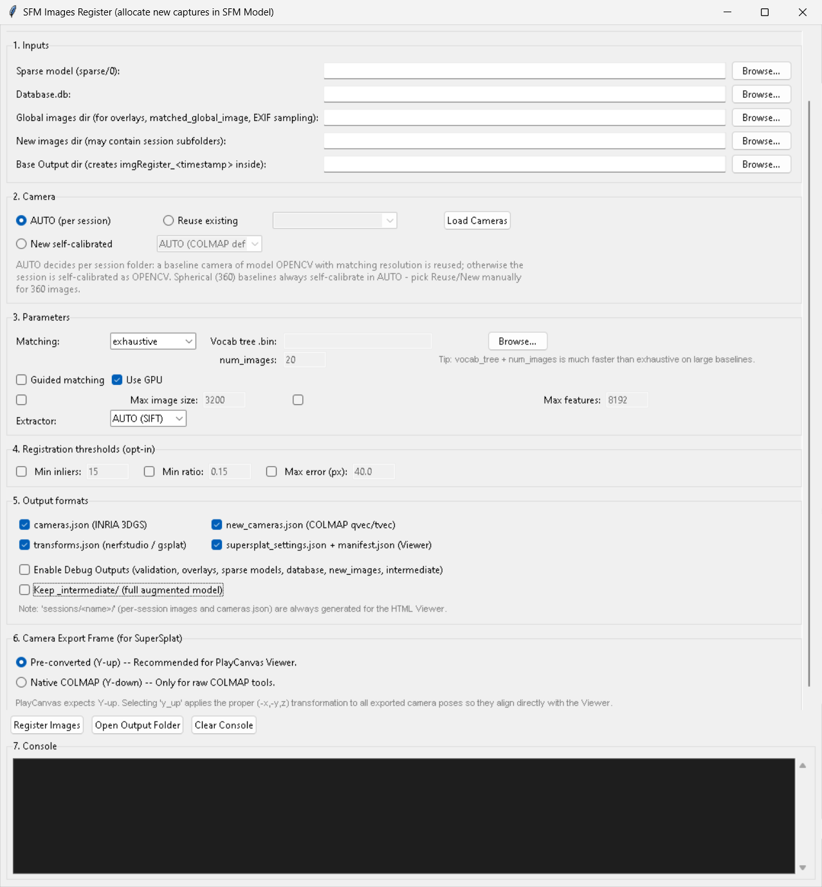
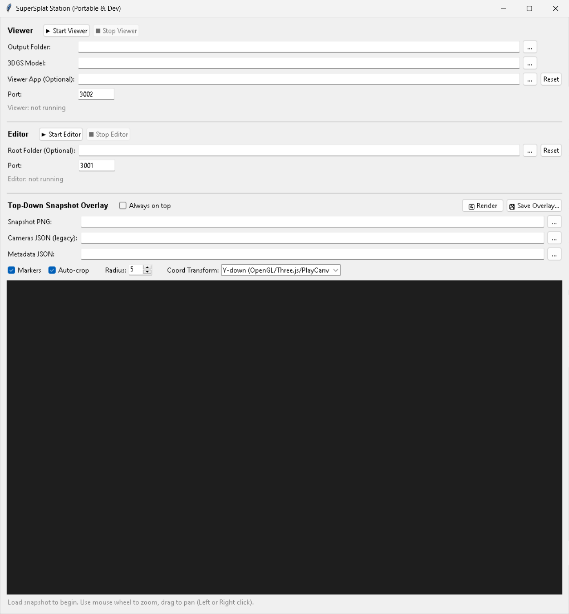

# Images Registration Pipeline: SFM Images Register & PortViewer

A lightweight, two-stage pipeline to register newly captured images into an existing COLMAP sparse model and interactively visualize the resulting camera poses.

## Motivation & Core Principle
Sparse models and downstream 3D Gaussian Splatting (3DGS) models are typically static. If you capture new photos of an environment, they lack camera poses and cannot be placed into the existing spatial context.

This repository bridges COLMAP and spatial visualization. Because the downstream 3DGS model is derived from the COLMAP reconstruction, newly registered camera poses can be visualized in the same spatial coordinate frame, **provided the model and exported poses preserve the same coordinate system and scale.**

The pipeline provides two standalone software packages to register new images, export their poses, and navigate them via a custom 2D/3D web interface.

## Architecture & Dataflow

The pipeline is cleanly divided into two standalone software packages:

| Component | Role | Input | Output |
| :--- | :--- | :--- | :--- |
| **SFM Images Register** (Stage 1 Package) | Core Registration | Existing Sparse model, DB, new images | `cameras.json`, `supersplat_manifest.json`, Session folders |
| **PortViewer** (Stage 2 Package) | Visualization Workspace | Stage 1 Output, 3DGS `.ply` model | Local HTTP Servers, Interactive 2D Overlay, `topdown.png/json` |

## Standard Output Format (Stage 1)
The **SFM Images Register** outputs a timestamped folder (e.g., `imgRegister_20261012_120000/`). This folder serves as the direct input for PortViewer.

~~~text
imgRegister_20261012_120000/
├── cameras.json               # Camera poses (see rotation convention below)
├── supersplat_manifest.json   # Web UI sidebar data
├── supersplat_settings.json   # 3D annotations for the viewer
└── sessions/                  # Grouped by capture session
    └── <session_name>/
        ├── cameras.json
        └── images/            # Thumbnails for the Web UI
~~~

**Data Convention Note:** In `cameras.json`, the `position` is the camera center in the world coordinate system. The `rotation` is a 3x3 matrix representing the **Camera-to-World (C2W)** rotation.

## Features
* **Intelligent Auto-Calibration (Stage 1):** Analyzes image resolutions and EXIF data to automatically group mixed devices and adjust COLMAP matching thresholds adaptively.
* **Robust Registration (Stage 1):** Uses COLMAP's `image_registrator` (PnP) to compute poses. Note that successful registration depends on sufficient feature overlap and good calibration.
* **Built-in Editor & Viewer (Stage 2):** PortViewer bundles a customized SuperSplat Editor (to generate top-down snapshots) and a SuperSplat Viewer (for 3D exploration with synchronized sidebars).
* **Top-Down 2D Overlay (Stage 2):** Reprojects 3D camera poses into a 2D orthographic snapshot. Clicking an image in the web UI instantly highlights its corresponding marker (red dot) on the 2D map.
* **Coordinate Transformations (Stage 2):** Provides preset axis mappings (OpenGL/PlayCanvas, COLMAP/OpenCV, WebXR, Blender) to accommodate different coordinate conventions from upstream models.

## Requirements (End-Users)
* **COLMAP** (Must be downloaded separately and accessible locally. Required by Stage 1).
* A modern web browser (Chrome or Edge) with WebGPU support (Required by Stage 2).

## How to Use

### Stage 1: Register New Images
Run the **SFM Images Register** executable (e.g., `sfm_images_register_v0_1_0.exe`).
1. Set the **Sparse Model** (`sparse/0` directory), **Database.db**, and the **Base Output dir**.
2. Set the **New Images dir** (can contain subfolders representing different capture sessions).
3. Locate your local **COLMAP** executable (e.g., `colmap.bat`).
4. Click **Register Images**. The tool will attempt to register the new images and output the standard metadata folder.

### Stage 2: Visualize with PortViewer
Run the **PortViewer** executable (e.g., `portviewer_v0_1_0.exe`).

**Step A: Generate the Top-Down Snapshot**
1. Click **▶ Start Editor** in PortViewer to open the integrated SuperSplat Editor.
2. Load your pre-trained 3DGS `.ply` model.
3. Adjust the camera to a strict orthographic top-down view.
4. Click **Render -> Top-Down Snapshot** to export `topdown.png` and `topdown.json`.

**Step B: Interactive Visualization**
1. In the PortViewer GUI, select the **Output Folder** generated in Stage 1.
2. Select your trained **3DGS Model** (`.ply`, `.splat`, `.sog`).
3. Select the **Snapshot PNG** and **Metadata JSON** generated in Step A.
4. Click **▶ Start Viewer**. 
5. Use the web interface to click through images and verify their 3D positions on the 2D top-down map.
